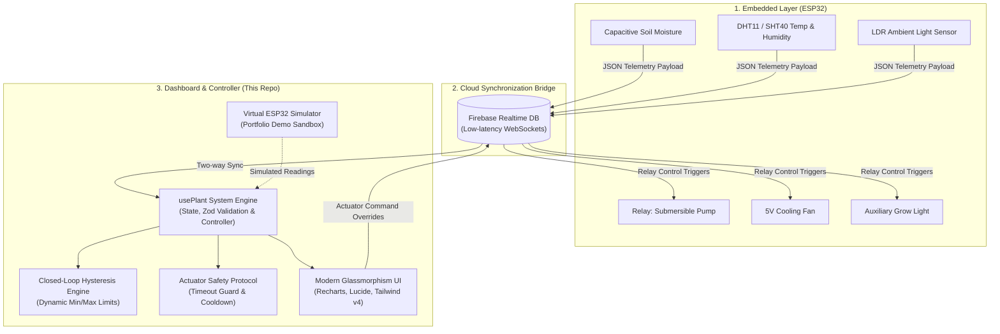

# 🌱 Smart Indoor Plant Control System – Web Dashboard & IoT Controller

[](https://react.dev/)
[](https://vitejs.dev/)
[](https://tailwindcss.com/)
[](https://zod.dev/)
[](https://firebase.google.com/)
[](https://www.buymeacoffee.com/ulasdursun)

A modern, high-resilience **IoT Telemetry and Closed-Loop Automation Dashboard** developed as the Capstone Project at **Bahçeşehir University (Department of Software Engineering)**.

Designed to interface with an ESP32 edge microcontroller via Firebase Realtime Database WebSockets, featuring dynamic agronomic threshold calibration, botanical profiles, hardware safety timeout guards, multi-metric telemetry charts, and an interactive virtual hardware sandbox for live portfolio demonstrations.

---

## 🧠 System Architecture



---

## ⚡ Key Engineering Features

### 1. 🎛️ Dynamic Agronomic Thresholds & Botanical Presets
* **Configurable Hysteresis:** Allows users to adjust the exact moisture trigger point (`minMoisture`) and cutoff point (`maxMoisture`) via interactive sliders or botanical presets.
* **Botanical Specimen Presets:**
  * **Monstera Deliciosa:** Min 35% – Cutoff 50% (Aerated tropical foliage)
  * **Sansevieria & Succulents:** Min 15% – Cutoff 25% (Arid drought-tolerant)
  * **Sweet Basil & Culinary Herbs:** Min 55% – Cutoff 72% (High transpiration)
  * **Ficus Lyrata (Fiddle Leaf Fig):** Min 30% – Cutoff 45% (Moderate moisture)
  * **Custom Agronomic Profile:** Full user control over arbitrary limits.

### 2. 🛡️ Client-Side Actuator Safety Protocol (UX Guardrails)
* **Max Continuous Run Timeout:** A browser-side safety guard that automatically sends a pump-stop command after an elapsed limit (configurable between 3s and 60s) during normal interactive sessions.
* **Hydration Soak Cooldown:** Enforces a mandatory front-end lockout period between irrigation cycles to allow water absorption into the substrate before re-triggering.
* **⚠️ Physical Hardware Safety Boundary:** Client-side timers run in the browser and **cannot substitute for microcontroller edge firmware safety**. If a client tab closes, crashes, or loses network connection while an actuator is energized, browser timers cannot turn off the relay. Real-world edge hardware deployments require independent on-device firmware safety (watchdog timers, hardware pulse cutoff, and fail-safe GPIO default state on boot/disconnect).

### 3. 🎮 Virtual ESP32 Hardware Simulator (Portfolio Demo Mode)
* An integrated **Hardware Sandbox** that can be toggled on/off with a single click.
* Generates realistic telemetry oscillations, diurnal temperature changes, and simulated root absorption dynamics (soil moisture climbs when the pump runs, and evaporates naturally over time).
* Enables hiring managers, recruiters, and reviewers to interact with all closed-loop controls **even when physical hardware is offline**.

### 4. 📊 Multi-Metric Telemetry & Visual Reference Bands
* Real-time line and area graphs powered by **Recharts**.
* Switch between **Soil Moisture (%)**, **Ambient Temperature (°C)**, and **Air Humidity (%)**.
* Dynamically overlays the user's active **Trigger** and **Cutoff** thresholds as dashed reference lines directly onto the moisture telemetry stream.

### 5. 📜 Real-Time System Audit & Event Logging
* Records every automated decision, manual override, safety intervention, and threshold adjustment with timestamps and category badges (`SYSTEM`, `PUMP`, `AUTO`, `SAFETY`, `ENVIRONMENT`).

### 6. 🩺 Telemetry Watchdog & Heartbeat
* Monitors telemetry latency and packet arrival times.
* Automatically updates device health badges:
  * `ONLINE`: Fresh telemetry received within the last 90 seconds.
  * `STALE`: Delayed packet transmission (90s – 300s).
  * `OFFLINE`: Hardware disconnected or powered down.

---

## 🧰 Tech Stack

| Domain | Technologies |
| :--- | :--- |
| **Framework & Build** | React 19, Vite 7 |
| **Styling & Design** | Tailwind CSS v4, Lucide React, Glassmorphism design system |
| **Schema Validation** | Zod (Runtime payload and settings validation) |
| **Charts & Visualization** | Recharts (Responsive area charts with SVG linear gradients) |
| **Cloud & Messaging** | Firebase Realtime Database (WebSocket transport) |
| **Code Quality** | ESLint 9 (Flat config, React 19 hooks standard) |

---

## 🚀 Installation & Setup

### 1. Clone the repository
```bash
git clone https://github.com/ulas-dursun/smart-indoor-plant-dashboard.git
cd smart-indoor-plant-dashboard
```

### 2. Install dependencies
```bash
npm install
```

### 3. Environment Variables
Copy `.env.example` to `.env` and fill in your Firebase project credentials (optional; fallback demo mode works out-of-the-box):
```bash
cp .env.example .env
```

### 4. Run Development Server
```bash
npm run dev
```

### 5. Production Build & Linting
```bash
npm run lint
npm run build
```

---

## 🔒 Firebase Security & Realtime Database Rules

A hardened, schema-validated rules definition is provided in [`database.rules.json`](./database.rules.json) with project mapping in [`firebase.json`](./firebase.json):
- **Deny-by-default Root:** Prohibits unrestricted writes across unmapped paths.
- **Actuator & Configuration Protection:** Requires authenticated identity (`auth != null`) to trigger relays (`actuators/waterPump`, `status/fan`, `status/led`) or alter closed-loop parameters (`system/thresholds`).
- **Telemetry Type & Range Validation:** Enforces numerical ranges (e.g. soil moisture: 0–100%, temperature: -40–85°C) and rejects unvalidated data injections at the database engine level.
- **Hysteresis Integrity Guard:** Rejects threshold updates where `maxMoisture <= minMoisture`.

To deploy these rules to your Firebase project:
```bash
firebase deploy --only database
```

---

## 📄 License & Citation

This project is licensed under the MIT License — see the [LICENSE](./LICENSE) file for details.

If you refer to or build upon this project for academic or technical study, please cite it using [`CITATION.cff`](./CITATION.cff).

---

## 👨‍💻 Author

**Ulaş Dursun**  
*Bahçeşehir University — B.Sc. Software Engineering Graduate*  
* Focus: Backend Systems, Concurrency, and Cloud-Native Engineering (Go, Java, Rust, Cloud Architectures)
* **GitHub:** [@ulas-dursun](https://github.com/ulas-dursun)  
* **LinkedIn:** [linkedin.com/in/ulas-dursun](https://www.linkedin.com/in/ulas-dursun)  
* **Support:** [](https://www.buymeacoffee.com/ulasdursun)
